# ProfitOps AI

## Multi-store weekly intelligence

The data import center now accepts tenant-scoped orders, campaign ads and inventory snapshot CSVs with preview, field mapping, atomic batch history and source-row traceability. Weekly Intelligence reuses the existing deterministic profit bridge, calculates separate store/SKU inventory risks and can request an evidence-checked LLM explanation. Missing feed coverage or model configuration is shown explicitly. Start locally with `python scripts/dev.py`; the web app runs at <http://127.0.0.1:5180> and API docs at <http://127.0.0.1:8010/docs>. CSV examples, migration, API and demo instructions: [docs/INTELLIGENCE.md](docs/INTELLIGENCE.md). Follow-up chat and external platform writes are outside this phase.

**跨境电商利润经营决策 Agent。** 销售额上涨、利润下降时，ProfitOps 从经营账本计算利润变化，定位会计贡献项，核验证据，生成待审批建议，经人工批准后执行**受控模拟**，并留下完整审计记录。

LangGraph + 确定性规则引擎，可选接入 **DeepSeek V4.1 Flash** 做根因解释与策略生成；没有 API Key 时自动降级为确定性规则，绝不把规则结果伪装成 LLM 输出。内置可离线运行的 **RAG 运营知识库**：Markdown 切分、BM25 + 向量混合检索（RRF）、`no_answer` 拒答、chunk 引用校验，以及可复现的检索评测。原生 Function Calling 的每一轮、每个工具调用、参数摘要、成功/失败、耗时与 token 都在工作台可见。另提供只读 **MCP Server**，通过 stdio 暴露利润分析、SKU 明细、RAG 检索和审批状态查询，不暴露审批/执行写工具。所有执行都明确标记 `simulation=true`，不调用真实广告、采购或付款系统。

> **数据边界**：仓库内的经营账本、知识库和评测案例均为合成数据，用于验证软件行为与契约，不代表真实商户经营效果；真实发生的是测试、浏览器/API 执行，以及可选的 DeepSeek/embedding 调用。完整清单见 [docs/DATA_PROVENANCE.md](docs/DATA_PROVENANCE.md)。

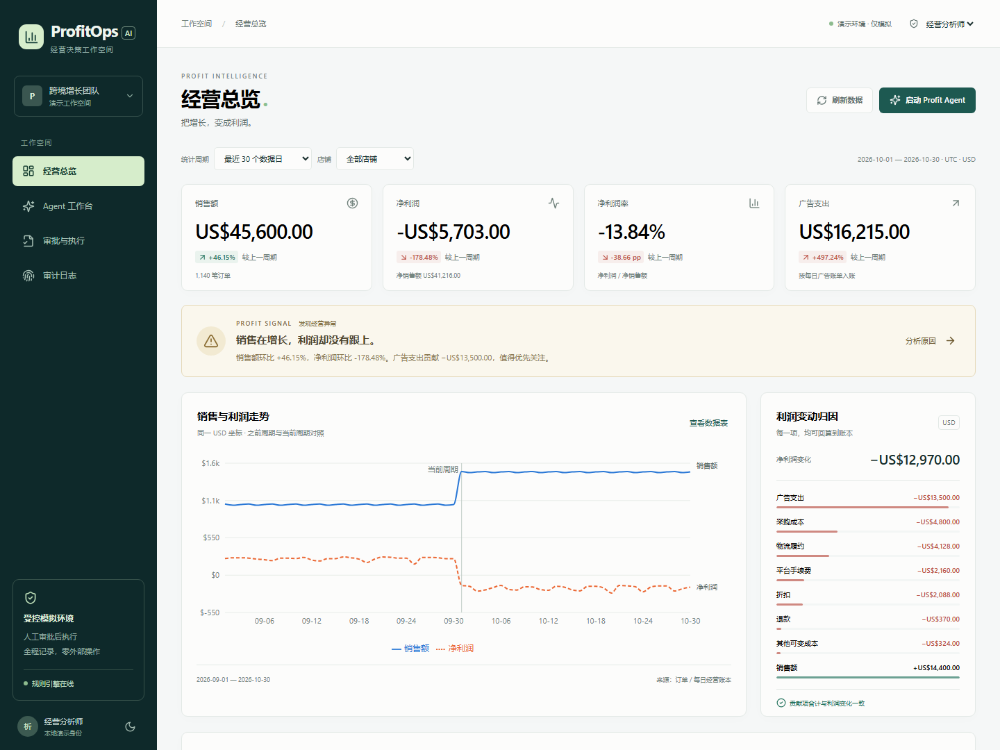

<details>
<summary>审批与模拟执行截图</summary>

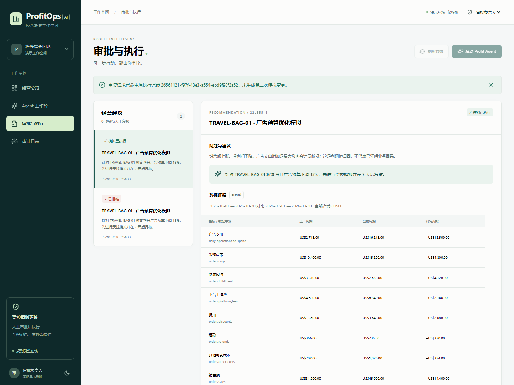

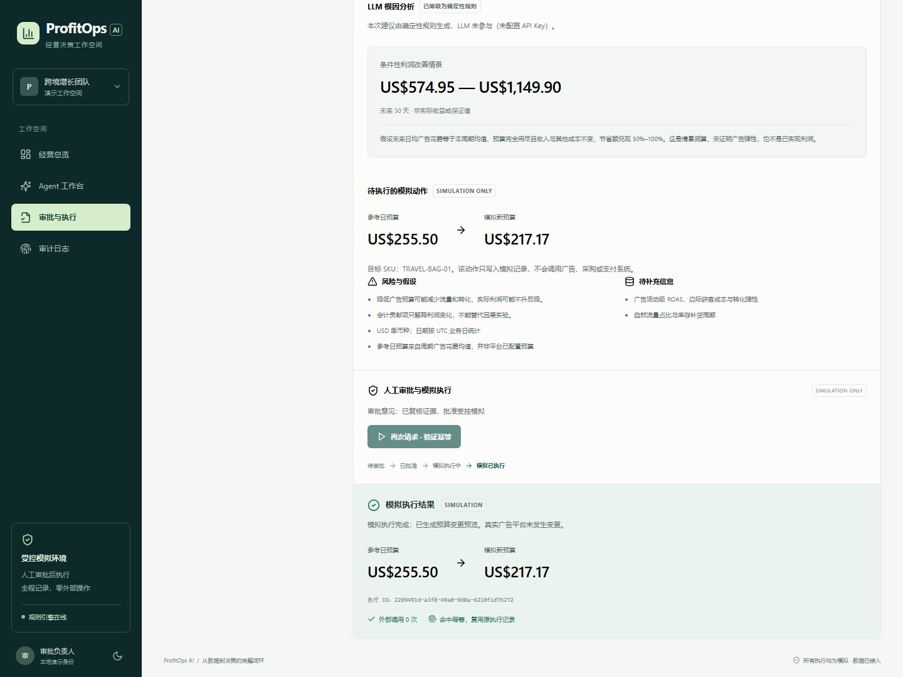
</details>

<details>
<summary>移动端布局截图</summary>

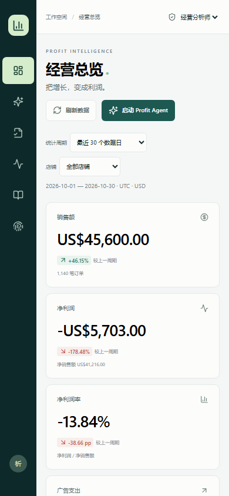
</details>

## 开发方式与协作边界

本项目由**本人担任技术负责人**：确定业务口径与利润公式、定义 API/数据库/状态机契约、设计评测门禁与验收标准、审查每次合并；**具体编码实现由 Claude Code 完成**。

仓库根目录的 `AGENTS.md` 就是给编码 Agent 的工作约定（禁止直接推 `master`、契约变更必须同步测试与前端类型、真实 LLM 调用不得进入 CI、未实际验证不得写成通过），它随项目存在，不是事后补写的说明。

取舍很明确：**吞吐来自 AI，判断必须来自本人**。哪些是本人做的、哪些是 AI 做的、怎么核对，见 [docs/COLLABORATION.md](docs/COLLABORATION.md)。

## 快速启动（本地，推荐）

前置：Python 3.11+、Node.js 20.19+、npm。无需 Docker 或外部数据库。

```powershell
git clone <repo> ProfitOps-AI
cd ProfitOps-AI
python scripts/dev.py
```

脚本会创建 `.venv`、按锁定版本安装依赖、自动初始化 60 天演示数据，并启动：

- 工作台：<http://127.0.0.1:5180>
- API 文档：<http://127.0.0.1:8010/docs>
- 健康检查：<http://127.0.0.1:8010/health>

端口被占用时可指定：`python scripts/dev.py --api-port 8020 --web-port 5190`。依赖已安装时可加 `--skip-install`。数据库位于 `data/profitops.db`；删除它可做全新初始化（会清除审批与审计历史）。

### 接入 DeepSeek（可选）

不配置任何变量也能完整运行。要启用真实 LLM，在项目根目录的 `.env`（已被 Git 忽略）或后端进程环境中设置：

| 变量 | 默认值 | 说明 |
|---|---|---|
| `LLM_PROVIDER` | `deepseek` | `deepseek` 或 `disabled` |
| `LLM_MODEL` | `deepseek-flash` | DeepSeek-V4.1-Flash-1017 的 API 模型 ID |
| `LLM_API_KEY` | 空 | 只放在本地 `.env` 或进程环境，不提交、不打印 |
| `LLM_BASE_URL` | `https://api.deepseek.com` | OpenAI 兼容接口根地址 |
| `LLM_TIMEOUT` | `20` | 单次请求超时秒数 |
| `LLM_MAX_TOKENS` | `4000` | 单次响应最大 token 数（256–8192） |
| `LLM_MAX_RETRIES` | `1` | 可重试错误的有界重试次数（0–3） |
| `LLM_FALLBACK_POLICY` | `rules` | `rules`：失败降级为规则；`fail`：分析失败并记录 `llm_failed` |
| `LLM_NATIVE_TOOLS` | `true` | 启用原生 Function Calling 只读工具循环 |
| `LLM_TOOL_MAX_ROUNDS` | `4` | 模型↔工具最大轮数（2–8） |
| `LLM_TOOL_MAX_CALLS` | `6` | 单次分析最大工具调用次数（1–12） |
| `LLM_TOOL_MAX_REPEATS` | `2` | 相同工具+参数允许重复次数（1–5） |
| `LLM_TOOL_BUDGET_SECONDS` | `90` | 工具循环总时间预算 |
| `LLM_TOOL_RESULT_MAX_BYTES` | `16384` | 单个工具结果回传上限（512–65536） |

DeepSeek Harness 里的 API 配置**不会**自动传给 FastAPI 后端，必须让后端进程自己读到上述变量；Docker Compose 会从项目根 `.env` 插值并注入这些变量。启用后，LangGraph 在确定性利润计算与证据校验之后先检索知识库，再调用 DeepSeek：模型可通过原生 Function Calling 请求 `get_profit_analysis`、`get_sku_breakdown` 与 `search_knowledge` 三个只读工具，服务端校验名称允许列表、`policy`、`effect`、角色、输入 Schema 和本次分析范围后，用可信账本或知识库执行并把结果回传模型；写建议、审批和执行工具永远不会暴露给模型。最终输出经 Pydantic 校验、所有 `evidence_id` 必须存在于本次确定性证据中、所有 `knowledge_references` 必须属于本次检索结果，才允许进入待审批建议；模型只负责解释与策略，不计算利润。轮次、调用次数、重复、总预算和结果大小均有上限，失败按 `LLM_FALLBACK_POLICY` 降级。

### 运营知识库 RAG（默认离线）

不配置任何变量即可使用 6 篇合成 SOP。默认 `hashing` embedding 完全离线，检索在 `verify_evidence` 之后、LLM 之前运行；命中片段进入分析结果和建议详情，LLM 只能引用本次返回的 `chunk_id`，未知引用会触发降级。低于阈值的查询返回 `no_answer=true`，不会拿低分片段凑答案。

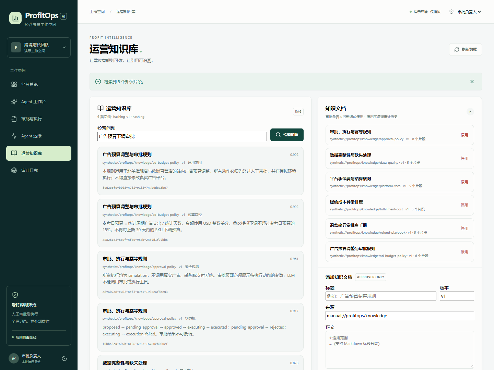

<details>
<summary>无可靠答案（拒答）截图</summary>

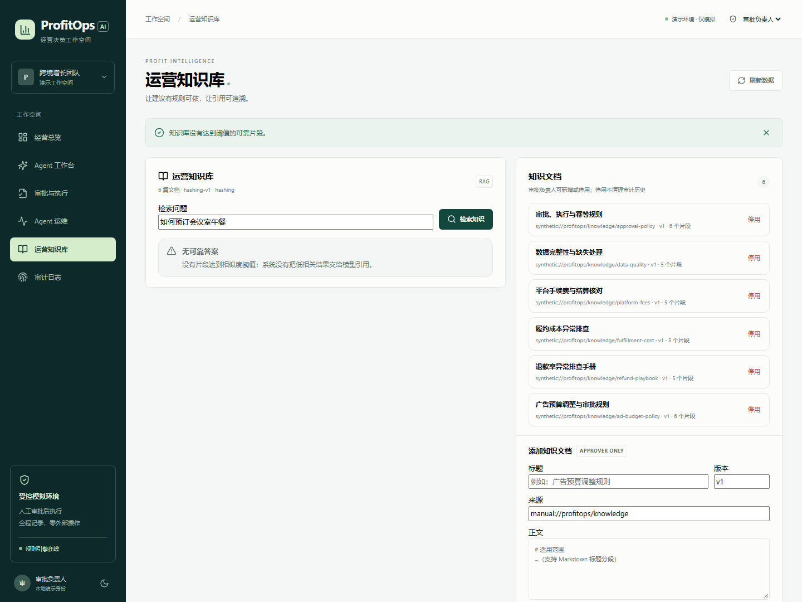
</details>

| 变量 | 默认值 | 说明 |
|---|---|---|
| `KNOWLEDGE_EMBEDDING_PROVIDER` | `hashing` | `hashing`（离线）或 `openai`（任意 OpenAI 兼容 `/embeddings`） |
| `KNOWLEDGE_EMBEDDING_MODEL` | `hashing-v1` | 写入 chunk 的模型标识；换模型需重新入库 |
| `KNOWLEDGE_EMBEDDING_BASE_URL` | 空 | openai Provider 必填 |
| `KNOWLEDGE_EMBEDDING_API_KEY` | 空 | SecretStr，不返回前端 |
| `KNOWLEDGE_EMBEDDING_DIMENSIONS` | `256` | hashing 维度（32–1024） |
| `KNOWLEDGE_CHUNK_CHARS` / `KNOWLEDGE_CHUNK_OVERLAP` | `600` / `100` | Markdown 切分与重叠 |
| `KNOWLEDGE_TOP_K` / `KNOWLEDGE_CANDIDATE_K` | `5` / `20` | 返回数与候选数 |
| `KNOWLEDGE_MIN_SCORE` | `0.15` | 拒答阈值（作用于 `confidence`；换 embedding 需重新校准，评测会给建议值） |
| `KNOWLEDGE_RETRIEVAL_MODE` | `hybrid_rrf` | `hybrid_rrf`（BM25 + 倒数排名融合）或 `weighted`（旧单一混合分） |
| `KNOWLEDGE_RRF_K` | `60` | RRF 平滑常数 |
| `KNOWLEDGE_BM25_K1` / `KNOWLEDGE_BM25_B` | `1.5` / `0.75` | BM25 参数 |
| `KNOWLEDGE_MAX_PER_DOCUMENT` | `2` | 单篇文档最多占几个片段 |

完整设计、API、打分公式与限制见 [docs/KNOWLEDGE.md](docs/KNOWLEDGE.md)。

切换 embedding 模型后，旧库可用 `scripts/reindex_knowledge.py` 就地重嵌入：先 `--dry-run` 预览，运行前备份数据库；它保留文档/chunk ID、标题和审计记录，只替换向量与 `embedding_model`。

### 经营数据导入与对账（CSV）

工作台新增 **数据导入** 页面：拖入订单或每日经营 CSV，先看逐行校验结果与金额合计，再由审批负责人确认写入。服务端不信任前端校验，提交时会重新解析同一份文件。

- **金额精确**：十进制字符串经 `Decimal` 转整数美分，拒绝浮点、科学计数法与超过两位小数。
- **整批原子**：任一行有问题整批不写，返回 409 和行号、字段、原因。
- **幂等重复**：同一文件重复上传只跳过，不产生第二份记录；字段被改动则按冲突拒绝，不静默覆盖。
- **写后对账**：flush 后按主键分批回读 `count` 与 `sum`，与文件合计逐项比较，不一致立即回滚。
- **权限与审计**：analyst 可预览，approver 可提交；记录 `import.committed` / `import.rejected`。

```bash
TOKEN=demo-approver
curl -X POST http://127.0.0.1:8010/api/imports/orders/preview \
  -H "Authorization: Bearer $TOKEN" -H "Content-Type: text/csv" \
  -H "X-Filename: orders-2026-11.csv" --data-binary @data/orders.csv
```

模板可下载：`GET /api/imports/template/orders` 与 `/api/imports/template/operations`。完整列定义、自然键与对账规则见 [docs/CONTRACT.md](docs/CONTRACT.md)。

### MCP Server（只读，stdio）

`backend/app/mcp_server.py` 通过 stdio 暴露同一套 Tool Registry 的四个只读工具：`get_profit_analysis`、`get_sku_breakdown`、`search_knowledge` 和 `get_approval_status`。RAG 检索与 HTTP/LangGraph 使用同一套知识库和 `chunk_id`；建议写入、审批和模拟执行不会暴露给 MCP 客户端。角色由 `PROFITOPS_MCP_ROLE` 在服务端决定，默认 `analyst`。

```bash
PYTHONPATH=backend .venv/Scripts/python.exe -m app.mcp_server
.venv/Scripts/python.exe scripts/mcp_check.py
```

MCP 进程不建表、不 Seed，使用前需先初始化数据库；默认 hashing embedding 不联网，只有显式配置远程 embedding 时才访问该网关。完整工具、客户端配置、安全边界和实测结果见 [docs/MCP.md](docs/MCP.md)。

降级状态在 API 与前端明确区分：`llm_success`、`deterministic_fallback`、`llm_failed`、`not_requested`。Agent 工作台的“Agent 执行轨迹”面板展示轮次、模型、`finish_reason`、工具名、参数摘要、成功/失败、错误码、单轮 token 与耗时、总 token/总耗时和终止原因；失败调用不会被显示成成功，参数与结果只显示有界摘要。真实调用一次并查看模型、耗时、Token 与证据引用：

```bash
.venv/Scripts/python.exe scripts/llm_check.py
```

未配置 Key 时脚本会输出 `{"status":"skipped","reason":"LLM_API_KEY 未配置"}` 并以退出码 2 结束，不会发起网络请求。

<details>
<summary>Agent 执行轨迹截图（失败调用与降级可见）</summary>

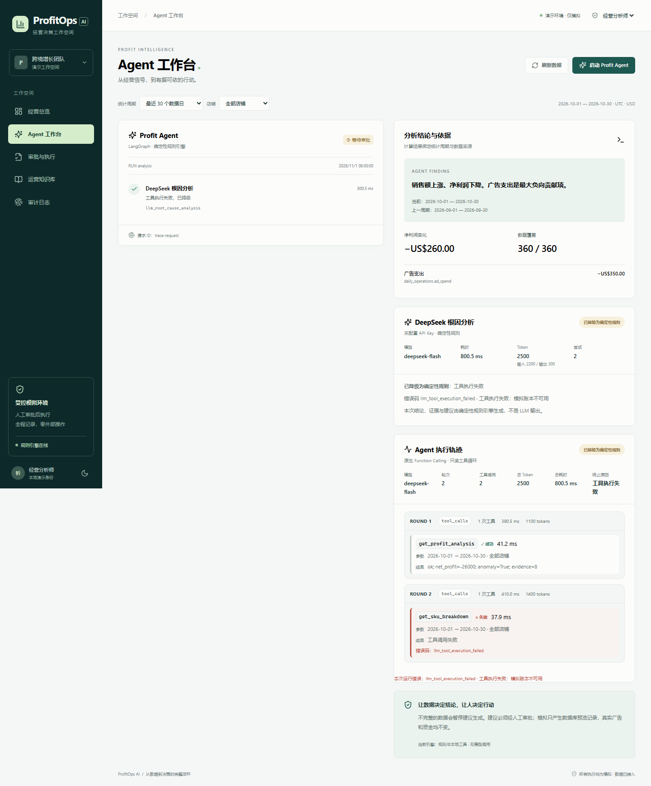
</details>

### Agent 评测（Phase 2D，默认离线）

一条命令运行原生 Tool Calling 离线评测：

```bash
.venv/Scripts/python.exe backend/evals/runner.py native
```

- 默认 `FakeToolProvider`，不联网、不消耗付费 token；脚本化的是模型响应，工具循环、工具注册表、只读处理器、参数/范围/轮次/重复限制和证据校验全部走生产代码。
- 4 个合成案例物化到独立临时 SQLite 账本，不读写 `data/profitops.db`。
- 输出机器可读 JSON 报告和终端摘要；正常运行或负向对照未通过时退出码非 0。
- 任一案例的 integrity 或 expected label 检查失败、oracle 缺失或零有效案例时，整次评测失败；报告 `dataset_checks.failed_cases` 记录案例与具体失败检查项，CLI 退出码非 0。
- Agent 执行轨迹只展示经过白名单校验的 `period`、`store_id`；其他字段只显示数量，非法或敏感值显示为“已隐藏”，不回显原始参数。
- 指标包括工具选择准确率、参数合法率、任务完成率、证据引用有效率、安全门禁通过率、降级率、token 与延迟。离线报告的 token/延迟来自脚本化 Provider，不是真实模型性能。
- 真实模型入口必须显式授权并设置预算：`native --real --authorize-real-calls I_UNDERSTAND_THIS_SPENDS_TOKENS --max-calls N`。CI 只运行默认离线模式。Phase 2D 未执行真实模型评测，不声明真实工具选择准确率。

口径和本次结果见 [docs/EVALUATION.md](docs/EVALUATION.md) 的 Phase 2D 章节。

### 离线 LLM 回放评测（默认离线）

```bash
.venv/Scripts/python.exe backend/evals/replay.py
```

- 固定 JSON 录制响应经过生产工具循环、Pydantic Schema 和证据校验；4 个合成案例，网络调用 0 次。
- 录制文件是合成的，不是真实模型 transcript；该评测只验证回放/解析/证据链路，不代表真实模型准确率。
- 详细口径见 [docs/EVALUATION.md](docs/EVALUATION.md) 的“离线 LLM 回放评测”。

### RAG 检索评测（默认离线）

```bash
# 默认：hashing，分别运行校准集与冻结测试集，对比 weighted 与 hybrid_rrf
.venv/Scripts/python.exe backend/evals/rag.py

# 只跑其中一个集合；测试集只消费冻结参数，不用于调阈值
.venv/Scripts/python.exe backend/evals/rag.py --dataset calibration
.venv/Scripts/python.exe backend/evals/rag.py --dataset test

# 历史 42 条统一集合仅用于回看旧报告
.venv/Scripts/python.exe backend/evals/rag.py --dataset legacy

# 真实 embedding：先只用 calibration 选阈值，再对 test 使用同一冻结值
.venv/Scripts/python.exe backend/evals/rag.py --dataset calibration \
    --embedding-provider openai --embedding-model qwen3-embedding:0.6b --min-score 0.15
.venv/Scripts/python.exe backend/evals/rag.py --dataset test \
    --embedding-provider openai --embedding-model qwen3-embedding:0.6b --min-score <校准阈值>
```

- 临时 SQLite，不联网、不读写 `data/profitops.db`（默认 hashing）。
- 6 篇合成 SOP；校准集 26 条（22 可回答、4 跨文档、4 不可回答），测试集 24 条（20 可回答、6 跨文档、4 不可回答）。两集合按 `id` 与查询文本双重去重，标签先行固定。
- 报告 hit@1、hit@3、MRR、nDCG@5、no-answer accuracy、citation validity、延迟，以及阈值校准建议；硬门禁失败时退出码非 0。
- 2026-11-13 hashing（`min_score=0.15`）结果：校准集 hit@1/hit@3 `100%`、MRR `1.0000`、no-answer/citation `100%`；测试集 hit@1 `85%`、hit@3 `95%`、MRR `0.8917`、nDCG@5 `0.9065`、no-answer/citation `100%`、跨文档 coverage@3 `66.67%`，网络调用 0。测试集保留 `test-quality-03`、`test-cross-01` 的 top-1 未中与 `test-cross-02` 的 top-3 未中，不修改标签凑分。
- 真实 embedding 的历史结论仍来自 42 条旧集合：**BGE-M3**（`min_score=0.42`）hit@1 100%、MRR 1.0000、跨文档覆盖 50%；`qwen3-embedding:0.6b`（`0.40`）hit@1 100%、跨文档覆盖 75%。这些结果只作历史对照，新 split 尚未用真实 embedding 重跑；换模型仍必须重新校准阈值。
- 报告写入 `backend/evals/reports/rag-split-latest.json` 与带日期的 `rag-split-20261113.json`；口径、门禁与失败案例见 [docs/KNOWLEDGE.md](docs/KNOWLEDGE.md) 第 9 节和 [docs/EVALUATION.md](docs/EVALUATION.md) 的 R9。

### Docker Compose（可选 PostgreSQL）

```powershell
docker compose up --build
```

工作台 <http://127.0.0.1:8080>，API <http://127.0.0.1:8010>。Compose 使用 PostgreSQL 16 和持久卷；只绑定回环地址。已在本机 Docker Desktop 29.5.3 实际启动并通过后端与 nginx 代理各 11/11 HTTP 冒烟，详见 `docs/TEST_REPORT.md`。验收时使用 `LLM_API_KEY=`、`LLM_PROVIDER=disabled`，不会调用真实模型。镜像内包含 `alembic.ini` 与 `migrations/`，可在容器中执行 `python -m alembic -c alembic.ini upgrade head`；启动仍保留兼容建表逻辑。

如需重新验收，可执行：

```bash
LLM_API_KEY= LLM_PROVIDER=disabled docker compose up --build -d
python scripts/smoke.py --base-url http://127.0.0.1:8010
curl -I http://127.0.0.1:8080
docker compose logs --tail=50 backend
docker compose down
```

### 云端单机 Compose（准备）

`compose.cloud.yaml` 在基线之上关闭 API 内 worker 和 BackgroundTasks，新增独立 `worker` 与一次性 `init`（Alembic + 种子），只发布 frontend 的 HTTPS 端口；backend、worker、db 不映射宿主机端口。`scripts/cloud_prepare.py` 生成不进入 Git 的随机数据库密码、JWT 密钥、演示 token、Basic Auth 口令和 TLS 材料。

```bash
python scripts/cloud_prepare.py --env-file .env.cloud --auth-dir deploy/auth --tls-dir deploy/tls --domain <domain> --https-bind 0.0.0.0 --https-port 443 --tls-mode existing
docker compose -f compose.yaml -f compose.cloud.yaml --env-file .env.cloud up -d --build
```

Windows 11 SSH 部署、首次初始化/迁移、备份恢复、故障排查、访问控制与十项本地验收记录见 [docs/CLOUD_DEPLOYMENT.md](docs/CLOUD_DEPLOYMENT.md)。本轮没有云服务器凭据，未实际部署公网；本地隔离 Compose 栈已验证，云端步骤仍需在目标主机复验。

### 可观测性与运行保护

- `GET /metrics` 输出 Prometheus 文本：HTTP 请求计数/耗时、分析任务事件与队列深度、工具调用、LLM 调用与熔断状态、限流命中。
- 登录/创建分析/其他 API 分别按 IP + Bearer token 哈希限流，超限返回 429 + `Retry-After`；`PROFITOPS_METRICS_ENABLED=false` 可关闭指标。
- LLM 连续可重试错误达到阈值后熔断，冷却后半开探测；熔断错误码 `llm_circuit_open` 仍按 `LLM_FALLBACK_POLICY` 降级或失败。
- 数据库迁移、队列排查、备份恢复、镜像构建和发布检查见 [docs/RUNBOOK.md](docs/RUNBOOK.md)。

## 演示流程（约 3 分钟）

1. 打开工作台。默认身份是“经营分析师”；总览显示销售额上涨、净利润下降，KPI、趋势图、利润归因和 SKU 明细均来自 API。
2. 点击 **启动 Profit Agent**。工作台逐步显示读取数据 → 利润计算 → 异常归因 → 证据核验 → 检索运营知识库 → DeepSeek 根因分析 → LLM 证据引用校验 → 创建建议 → 等待审批，每步有耗时、摘要和请求 ID。未配置 Key 时 LLM 步明确显示“已降级为确定性规则”，但知识检索仍会运行。
3. 查看 **Agent 执行轨迹**：原生工具循环的每一轮、工具调用、参数摘要、成功/失败、错误码、单轮 token/耗时和终止原因。然后点击 **查看经营建议**，查看 LLM 根因/置信度/证据引用、知识库片段及“✓ LLM 已引用”标记（若真实调用成功）、统计周期、上一周期、8 项利润贡献、预期影响情景、风险与待补充信息。
4. 以分析师身份尝试批准：页面不提供按钮；直接用 API 伪造 `X-Role` 会返回 403。右上角切换为 **审批负责人**。
5. 审批页先展示 **待执行的模拟动作**：目标 SKU、参考日预算、模拟新预算。填写审批意见并 **批准建议**；批准时服务端重新读取账本并写入版本快照，页面显示账本/动作短指纹。若审批后账本或动作参数变化，执行会返回 409 并保持 `approved`。核对快照后 **模拟执行已批准动作**，结果显示 `SIMULATION`、预算预览、外部调用 0 次。
6. 再次点击 **再次请求 · 验证幂等**。返回同一执行 ID，并提示“命中幂等”，数据库没有第二条执行记录。
7. 打开 **审计日志**：在“请求 ID”输入框精确过滤，追踪分析、批准、开始执行、成功执行、重复回放和被拦截请求。
8. 拒绝分支：启动另一次分析，在审批中心填写原因并拒绝；建议进入终态，无法再批准或执行。
9. 运营知识库：打开 **运营知识库** 页面，检索“广告预算下调审批”，查看命中片段、来源/版本、分数和引用标记；再输入“如何预订会议室午餐”，页面显示“无可靠答案”。切换审批负责人后可新增或停用文档（analyst 只能读）。

演示身份（公开、仅本地）：

| 身份 | Bearer token | 权限 |
|---|---|---|
| 经营分析师 | `demo-analyst` | 查看、发起分析、初始化数据 |
| 审批负责人 | `demo-approver` | 上述权限 + 审批/拒绝 + 模拟执行 |

这是演示身份机制，**不是生产级认证**。

### 端到端演示验证（2026-11-07）

在独立端口（后端 8020 / 前端 5190）、临时 SQLite 库、`LLM_PROVIDER=disabled`、`hashing` embedding 下实际执行了总览、Agent 分析、越权拦截、审批、模拟执行、幂等、知识命中/拒答与审计链路（拒绝分支本轮未覆盖）：浏览器操作与 API 断言共 29 项全部通过，无浏览器 console/page error。演示未触碰默认 8010/5180 的本地数据，没有调用付费模型，也没有任何真实外部副作用。账本来自 `backend/app/seed.py` 的确定性合成种子（2 店铺 × 3 SKU × 60 天，1,920 条订单），知识库为 6 篇合成 SOP；29 项检查验证的是软件行为与契约，不是真实经营效果。原始证据（29 项检查、请求 ID、执行 ID 与响应字段）见 [evidence.json](docs/screenshots/demo-20261107/evidence.json)。

| 环节 | 实测结果 |
|---|---|
| 经营总览 | 销售额 `US$45,600.00`（4,560,000 美分）、净利润 `-US$5,703.00`；异常标记与利润桥守恒均为 true |
| Agent 工作流 | 10 个 LangGraph 步骤全部 completed，状态 `waiting_approval`；LLM 未配置时降级为确定性规则且状态可见 |
| 建议与证据 | 8 项证据均带 `evidence.id` 与 `source`；知识库检索命中 5 个可引用片段 |
| 越权拦截 | 分析师界面无「批准建议」按钮；用分析师 token 伪造 `X-Role: approver` 调用 API 返回 `403` |
| 审批与执行 | 审批负责人批准后模拟执行：`simulation=true`、`external_calls=0`，日预算 `US$255.50 → US$217.17`（25,550 → 21,717 美分） |
| 执行幂等 | 再次请求返回同一 `execution_id`，页面提示「重复请求已命中原执行记录」 |
| 知识检索 | 「广告预算下调审批」命中 5 个片段、`no_answer=false`；「如何预订会议室午餐」`no_answer=true` |
| 审计链路 | 按 `request_id` 过滤得到 `analysis.requested` 等事件；全量审计同时包含 `recommendation.approve`、`execution.executed`、`execution.replayed` |

| 经营总览 | Agent 工作流 |
|---|---|
| 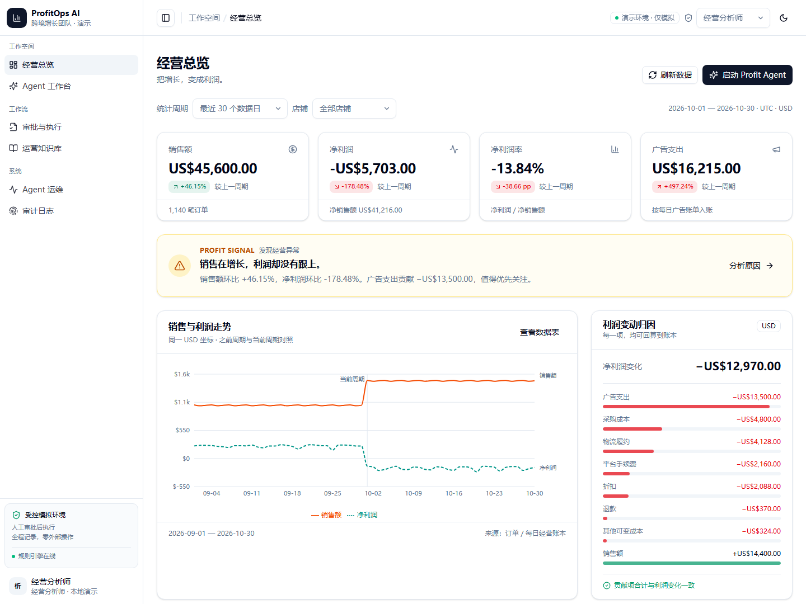 | 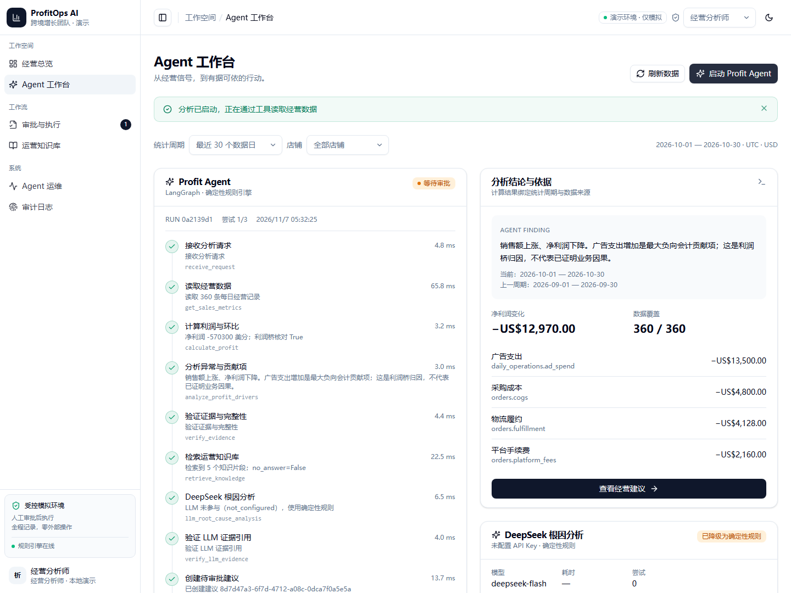 |

| 待审批建议 | 模拟执行 |
|---|---|
| 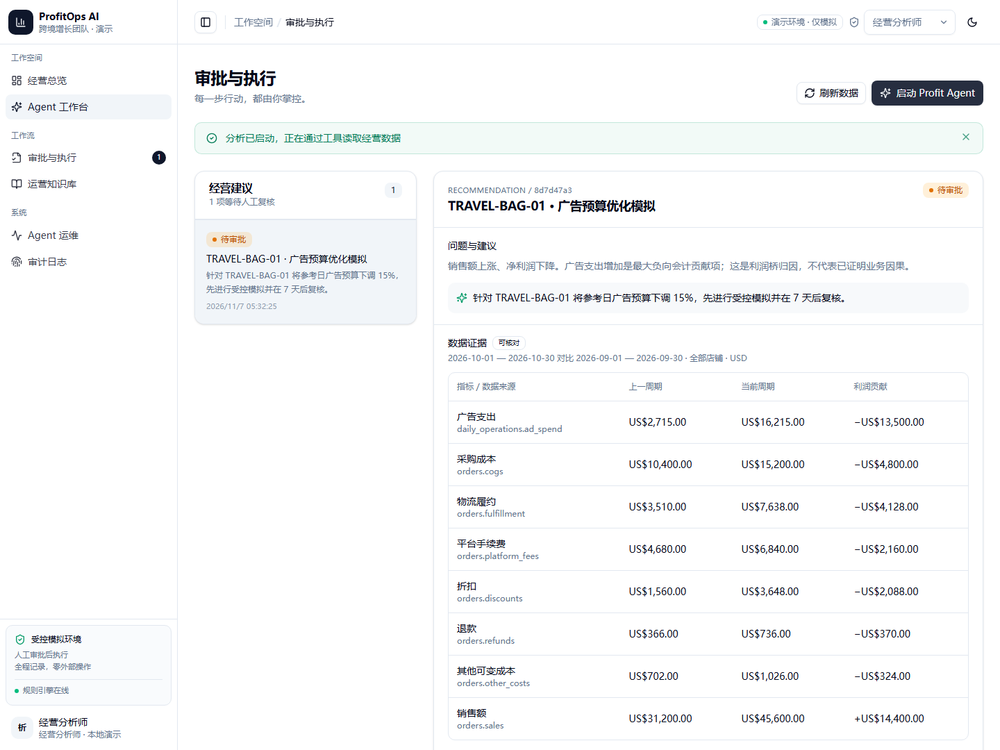 | 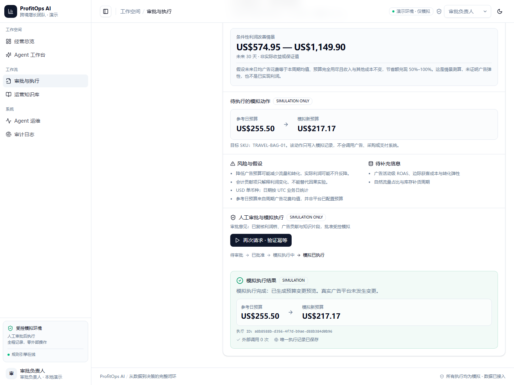 |

<details>
<summary>展开其余 4 张截图</summary>

| 幂等回放 | 知识命中 |
|---|---|
| 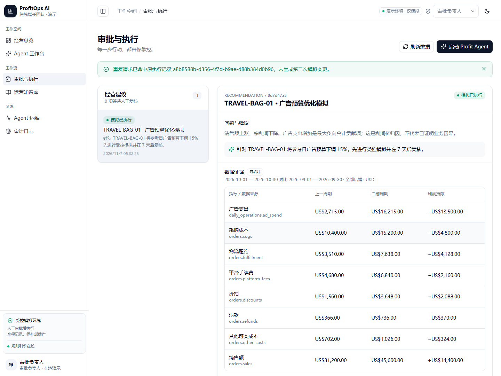 | 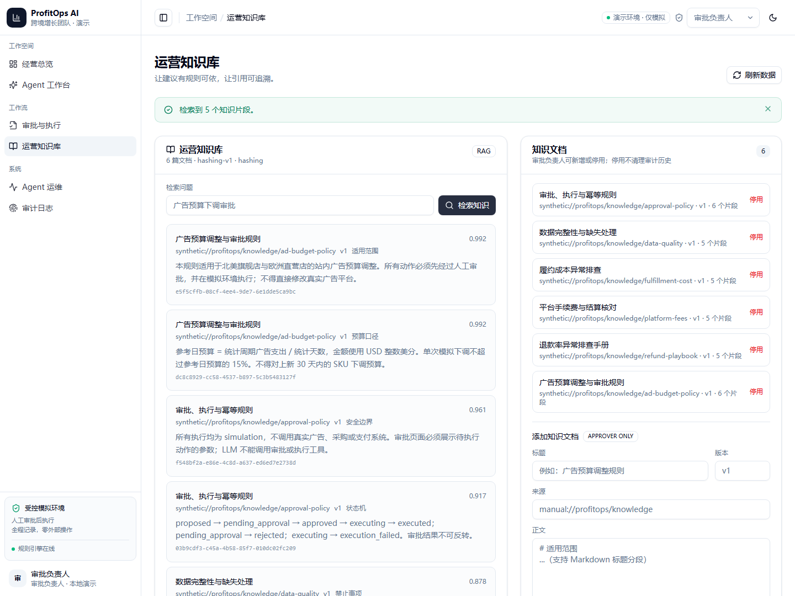 |

| 知识拒答 | 审计过滤 |
|---|---|
| 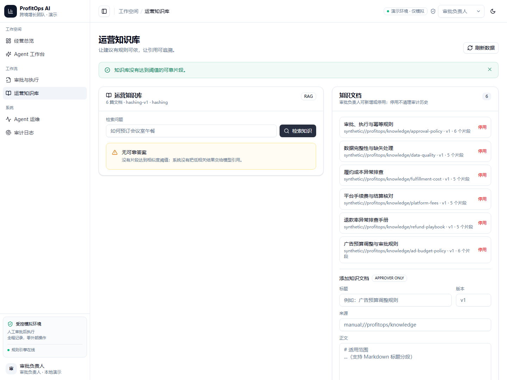 | 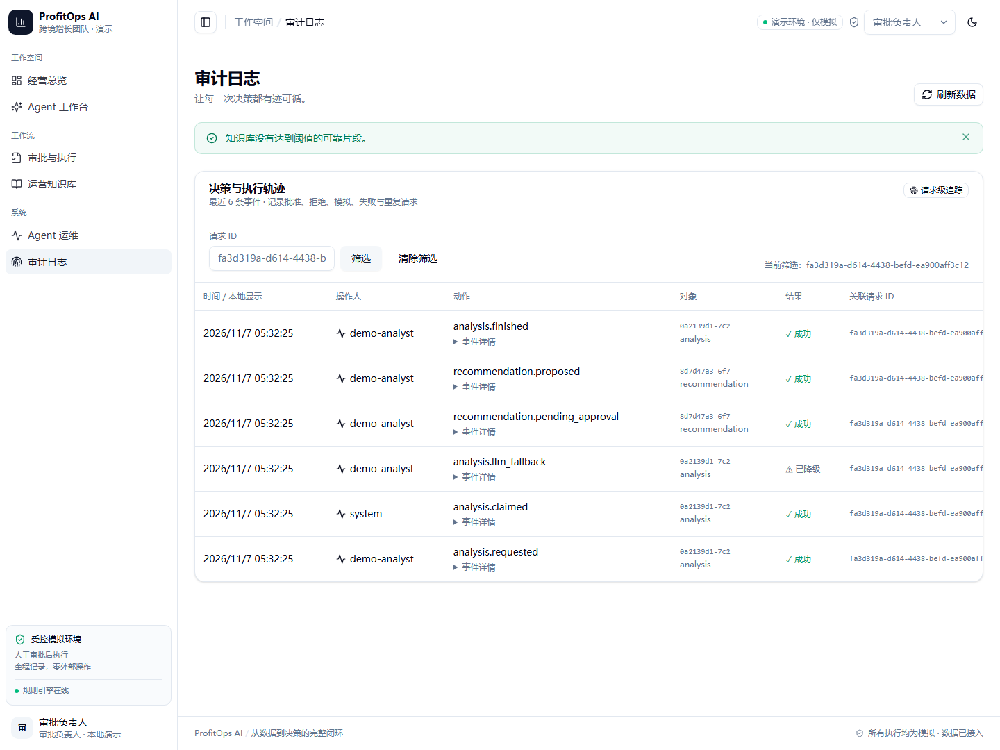 |

</details>

> 离线 `hashing` 的拒答阈值使用 `KNOWLEDGE_MIN_SCORE=0.15`（本次演示显式设置）。如果本地 `.env` 是按 BGE-M3 校准的（例如 `0.42`），切回 `hashing` 时必须同步下调，否则知识检索会全部拒答。

## 核心业务口径

金额以 USD 整数美分存储和传输，避免浮点误差。

```
净销售额 = 销售额 − 折扣 − 退款
净利润   = 净销售额 − 采购成本 − 广告支出 − 物流履约成本 − 平台手续费 − 其他可变成本
利润率   = 净利润 / 净销售额 × 100%        （分母为 0 → null）
环比     = (当前 − 上一周期) / |上一周期| × 100%（上一周期为 0 → null）
```

统计区间为 UTC 闭区间。当前周期默认最近 30 个数据日，上一周期为紧邻的等长周期；支持 7/30 天与店铺筛选，API 允许自定义最多 90 天。订单成本字段彼此独立，广告支出来自每日经营账本，不在订单中重复；退款只扣收入，采购成本已是退货后残值。每日经营记录缺失或标记不完整时，Agent 停止在 `insufficient_data`，不生成可执行建议。

完整契约见 [docs/CONTRACT.md](docs/CONTRACT.md)，设计决策见 [docs/ARCHITECTURE.md](docs/ARCHITECTURE.md)。

## API 示例

```bash
# 健康检查（无认证）
curl http://127.0.0.1:8010/health

# 经营指标
curl -H "Authorization: Bearer demo-analyst" "http://127.0.0.1:8010/api/metrics?start_date=2026-10-01&end_date=2026-10-30"

# 发起分析（可选 Idempotency-Key）
curl -X POST http://127.0.0.1:8010/api/analyses \
  -H "Authorization: Bearer demo-analyst" -H "Content-Type: application/json" \
  -H "Idempotency-Key: demo-analysis-001" -d '{}'

# 批准（仅 approver，且仅 pending_approval）
curl -X POST http://127.0.0.1:8010/api/recommendations/<id>/approve \
  -H "Authorization: Bearer demo-approver" -H "Content-Type: application/json" \
  -d '{"reason":"已复核利润桥与数据完整性"}'

# 模拟执行（必须 Idempotency-Key）
curl -X POST http://127.0.0.1:8010/api/recommendations/<id>/execute \
  -H "Authorization: Bearer demo-approver" -H "Idempotency-Key: exec-001"

# 审计
curl -H "Authorization: Bearer demo-analyst" "http://127.0.0.1:8010/api/audit-logs?object_id=<id>"

# 知识库检索（analyst / approver）
curl -X POST http://127.0.0.1:8010/api/knowledge/search \
  -H "Authorization: Bearer demo-analyst" -H "Content-Type: application/json" \
  -d '{"query":"广告预算下调审批","top_k":3}'

# 新增知识文档（仅 approver；相同正文幂等）
curl -X POST http://127.0.0.1:8010/api/knowledge/documents \
  -H "Authorization: Bearer demo-approver" -H "Content-Type: application/json" \
  -d '{"title":"退款升级规则","source":"synthetic://profitops/knowledge/refund-escalation","content":"# 退款升级\n\n退款率连续 7 天高于基线时升级为运营专项。"}'

# 重新索引已有文档（仅 approver；切换 embedding 模型后使用）
curl -X POST http://127.0.0.1:8010/api/knowledge/documents/<id>/reindex \
  -H "Authorization: Bearer demo-approver"
```

错误格式统一为 `{"error":{"code","message","details"},"request_id":"..."}`；响应头也包含 `X-Request-ID`。`/docs` 提供 OpenAPI 文档。九个工具及其 JSON Schema 可通过 `GET /api/tools` 查询。

## 测试

```powershell
.venv/Scripts/python.exe -m pytest backend/tests -q
npm --prefix frontend test
npm --prefix frontend run build
.venv/Scripts/python.exe backend/evals/rag.py      # RAG 检索评测，离线
.venv/Scripts/python.exe backend/evals/replay.py   # LLM 录制响应回放，离线
.venv/Scripts/python.exe scripts/mcp_check.py      # MCP stdio 真实子进程检查
.venv/Scripts/python.exe scripts/migrate.py upgrade head
.venv/Scripts/python.exe scripts/smoke.py          # 需服务已启动
.venv/Scripts/python.exe scripts/browser_test.py   # 安装项目本地 Chromium 后跑真实浏览器验收
```

当前实测结果（2026-11-03，RAG 分支）：后端 277 通过、6 跳过（跳过项均为未设置 `PROFITOPS_TEST_POSTGRES_URL` 的 PostgreSQL 测试）、新增 BM25/融合测试 5 通过、RAG 离线评测（weighted 与 hybrid_rrf）退出码 0、BGE-M3 与 qwen3-embedding 真实检索评测退出码 0、前端生产构建通过；前端单测本轮未重跑（上一轮 17 通过），MCP 专项 9 通过、MCP stdio 检查、HTTP 冒烟 15/15 与云端单机 Compose 十项验收均为既有结果，本轮未重新执行。详见 [docs/TEST_REPORT.md](docs/TEST_REPORT.md)。以下为历史阶段记录：后端 204 通过、4 跳过、前端 15 通过；离线 LLM 回放评测 4/4 通过、网络调用 0 次；RAG 离线评测 hit@3 100%、no-answer 100%、citation validity 100%，网络调用 0 次；HTTP 冒烟 15/15 通过，`/metrics` 实际返回 HTTP、任务、工具和队列指标。Phase 2D 原生 Tool Calling 离线评测 37 次运行：正常 3/3、负向对照 34/34、安全门禁 37/37，真实网络调用 0 次。Phase 2C 历史 HTTP 冒烟 11/11 通过，历史阶段 Docker Compose 下后端直连与 nginx 代理各 11/11、Chromium 真实浏览器 E2E 2 通过。Phase 2C 原生 Function Calling 另执行 3 次真实脚本运行：第 1 次第 2 轮网络错误降级，第 3 次完整成功（`native_tools=true`、`final_answer`、20482.961 ms、10706 tokens、2 个只读工具调用、`all_references_valid=true`）。历史 Phase 2A/2B 真实调用 22 次，均为单次 JSON 路径；`max_tokens=4000` 的三次重复 9/9 `llm_success`、9/9 `finish_reason=stop`，当前评分器重评后广告、履约、退款均 3/3；此前 `max_tokens=3000` 的三次重复重评后为 6/9，3 次截断。Phase 2D 未执行真实 `native --real` 调用。详见 [docs/EVALUATION.md](docs/EVALUATION.md) 和 [docs/LLM_LIVE_CHECK.md](docs/LLM_LIVE_CHECK.md)。

2026-11-07 在 UI 改版与端到端演示中实际执行：前端单测 17 通过、生产构建通过、Playwright e2e 7 通过、HTTP 冒烟 15/15、端到端演示 29/29（8 张截图，见上文）；后端 pytest 本轮未重跑。

## 项目结构

```
backend/app/         FastAPI、模型、利润计算、知识库、工具、LangGraph、LLM Provider、MCP Server、审批执行、审计
backend/tests/       单元、集成、工作流、并发、知识库、评测
backend/evals/       LLM Agent 评测样本、RAG/回放评测、Runner 与报告
backend/migrations/  Alembic 基线与增量迁移
frontend/src/        React 工作台、API 类型、交互测试
frontend/e2e/        Playwright 真实浏览器验收
scripts/             一键启动、迁移、HTTP 冒烟、浏览器测试、MCP/真实 LLM 验证、知识库重嵌入
docs/                契约、架构、运行手册、云端部署、知识库、MCP、验证记录、截图
compose.yaml         PostgreSQL + 后端 + 前端
compose.cloud.yaml   云端单机覆盖：独立 worker、一次性 init、HTTPS 入口
scripts/cloud_prepare.py 生成非 Git 的云端密钥、htpasswd 与 TLS 材料
AGENTS.md            开发约定
TASKS.md             交付与后续任务
```

## 已知限制

- 认证是可运行的自建账号 + JWT + 租户隔离，但不是完整生产 IAM：没有 OIDC/SSO、密码重置、MFA、密钥轮换和租户管理后台；限流桶和指标是进程内状态，多副本部署需要共享存储。本地演示工作台使用 `/api/demo` 返回的 demo token 切换身份；云端覆盖把该接口放在 Nginx Basic Auth 之后，token 由不进入 Git 的随机配置生成，但仍不是正式认证。JWT 登录 API 已实现并有后端测试，演示前端未接入登录页，非 demo 模式需要登录客户端。
- LLM 只负责解释与策略文案，利润、环比、贡献桥和动作参数始终由确定性代码计算；归因是会计贡献项，不是因果证明。真实 DeepSeek 共调用 22 次（首轮 3 次 + 退款重跑 1 次 + 3000 三次重复 9 次 + 4000 三次重复 9 次）。3000 三次重复重评后为履约 3/3、广告 2/3、退款 1/3，3 次失败均为 `finish_reason=length`；提高到 4000 后同一组三次重复为 9/9 `llm_success`，重评后广告/履约/退款均 3/3。评测结果见 [docs/EVALUATION.md](docs/EVALUATION.md)；这是 3 个合成案例上的门禁结果，不是准确率。未配置 Key 时默认走确定性降级。
- 原生 Function Calling 已用 3 次真实脚本运行验收；第 3 次完整成功，但样本很小，不能据此声明真实调用成功率或多轮稳定性。
- RAG 默认 hashing embedding 是离线工程方案，不是语义模型；6 篇合成 SOP、26/24 条拆分查询的评测只验证检索/拒答/引用链路，不代表真实业务文档或通用语义准确率。测试集是合成回归 holdout，且历史失败案例在拆分前已经已知。BGE-M3 与 qwen3-embedding 的历史结论来自 42 条旧集合，新 split 尚未用真实 embedding 重跑；换模型必须重新校准 `KNOWLEDGE_MIN_SCORE`。未实现文档级 ACL、PDF/OCR、reranker 或专用向量数据库；当前是 SQLite/PostgreSQL 上全量候选打分，知识库规模增大后需要专用向量索引与批处理/缓存。
- Phase 2D 工具调用评测默认使用脚本化 `FakeToolProvider`，37 次运行只证明生产工具循环和门禁在合成案例上的行为，不是真实模型的工具选择准确率；`native --real` 入口已实现但本阶段未授权执行。
- 预期影响是明确标注的条件性情景，不构成收益承诺。
- 模拟执行只写数据库预览，不改变任何真实平台。
- 超时在步骤结束后检查，不能强制中断阻塞中的同步工具。
- 已加入 Alembic 基线和迁移入口；旧库仍依赖启动时的兼容迁移补充租户/任务字段，后续 schema 变更必须新增显式 revision。Alembic 未安装时相关测试会跳过，CI 会安装并执行 upgrade/downgrade。
- Docker/PostgreSQL 容器已在本机 Docker Desktop 验证；云端单机覆盖也在隔离栈完成十项验收（见 `docs/CLOUD_DEPLOYMENT.md`）。其他机器和真实云服务器仍需按文档复验。
- MCP 只实现了 stdio 只读服务（4 个工具），没有网络 transport、OAuth、多租户隔离和 MCP 侧审计；写工具永不暴露给客户端。

## 交付与验收材料

- [docs/DATA_PROVENANCE.md](docs/DATA_PROVENANCE.md)：合成数据清单、真实执行范围，以及能支撑/不能支撑的结论。
- [docs/COLLABORATION.md](docs/COLLABORATION.md)：开发方式、AI 协作边界，以及哪些判断由本人负责。
- [docs/HANDOFF.md](docs/HANDOFF.md)：交付报告、实际验证结果、未完成项与下一步顺序。
- [docs/CLOUD_DEPLOYMENT.md](docs/CLOUD_DEPLOYMENT.md)：云端单机 Compose、初始化/迁移、备份恢复、故障排查与访问控制。
- [docs/FINAL_DEMO_ACCEPTANCE.md](docs/FINAL_DEMO_ACCEPTANCE.md)：最终端到端模拟验收报告与修复复验记录。
- [docs/LLM_LIVE_CHECK.md](docs/LLM_LIVE_CHECK.md)：DeepSeek 真实调用的模型、耗时、Token、结构化输出与证据校验记录。
- [docs/KNOWLEDGE.md](docs/KNOWLEDGE.md)：RAG 数据模型、切分、embedding、混合检索与 RRF、引用校验、API 与限制。
- [docs/RAG_BGE_M3_2026-11-03.md](docs/RAG_BGE_M3_2026-11-03.md)：BGE-M3 的 GGUF 来源、字节校验、42 条查询对比与阈值校准。
- [docs/EVALUATION.md](docs/EVALUATION.md)：Phase 2B Agent 评测、Phase 2D 原生工具评测与 RAG 检索评测记录。

## 演示与讲解建议

重点讲四件事：**业务闭环**（数据 → 利润桥 → 证据校验 → 知识检索 → 人工审批 → 幂等模拟 → 审计）、**可信 Agent 设计**（确定性计算、证据绑定、数据不足不生成建议、持久化暂停点、失败可见）、**可信 RAG**（混合检索、`no_answer` 拒答、chunk 引用校验、知识内容按不可信数据处理）、**服务端安全**（角色不信任前端、条件状态更新、唯一约束与事务、请求 ID）。可以打开利润归因核对 8 项贡献之和、故意用分析师 token 调批准接口、连续两次执行观察同一执行 ID，作为现场可验证的证据。

本项目定位为 MVP，不把演示认证、规则引擎或模拟动作说成生产能力。
