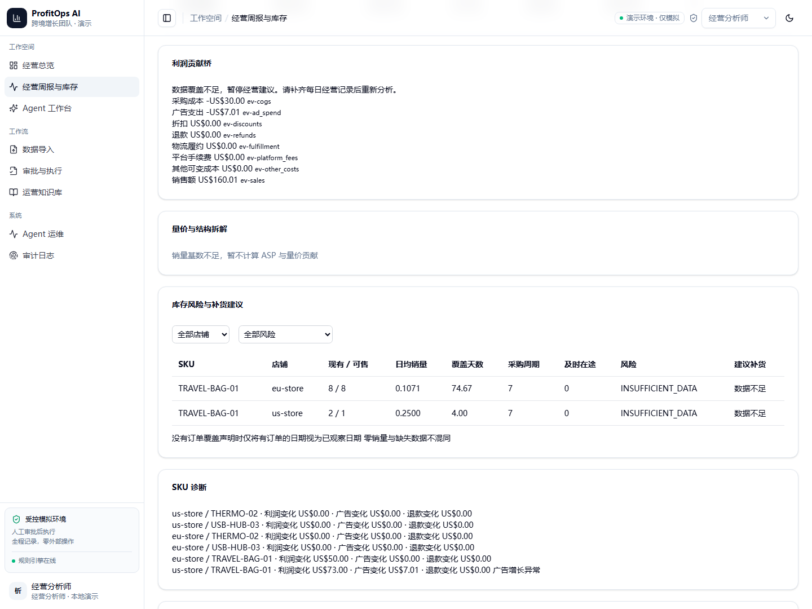
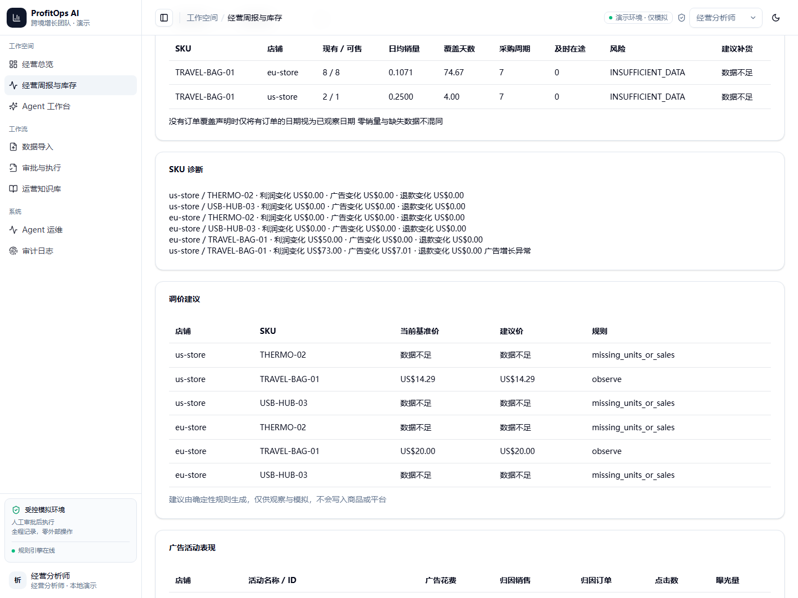
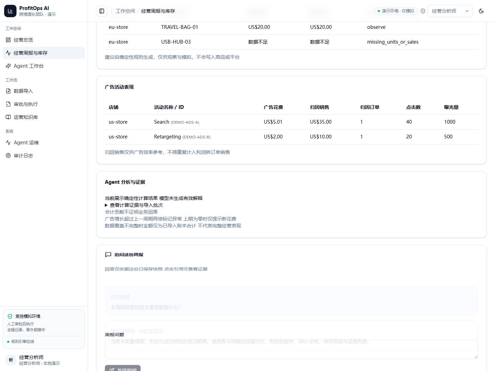
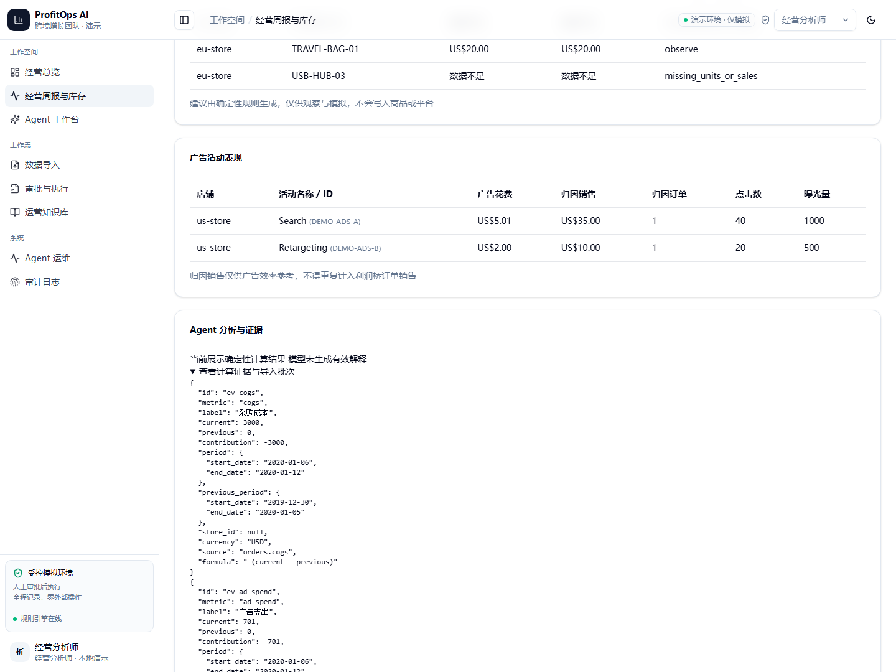

# 周报增量交付记录 2026-11-14

本轮为 AI 辅助实现与验证；按项目约定以功能分支提交 PR，未部署公网，也没有对运行库执行迁移。复用现有利润桥、LangGraph、shadcn/ui 与导入服务，没有引入第二套利润公式。

## 实现范围

- Decimal 量价结构拆解及独立证据，保留原有八项利润贡献桥
- 确定性调价建议，只读展示，不执行改价
- Amazon / Shopify 风格 CSV 字段适配与样例，不代表连接真实平台
- 活动级广告诊断与证据，归因销售不重复计入利润
- MCP 增加已保存周报读取，七个只读工具，租户过滤不放宽
- SKU 唯一性改为租户内唯一，同租户店铺共享商品目录
- 追问执行意图拒绝、显式 Alembic URL 支持

## 迁移

新增 `0006_tenant_scoped_sku`，接在 `0005_weekly_chat` 后。SQLite 重建 products，移除旧全局唯一约束，保留数据及子表关联，校验外键；PostgreSQL 使用约束变更。回退前检查跨租户重名，存在重复则拒绝回退，不删数据。

先备份并在副本验证。使用显式路径运行，例如：

```powershell
$env:PROFITOPS_DATABASE_URL = 'sqlite:///E:/ProfitOps-AI/data/demo-copy.db'
.venv/Scripts/python.exe scripts/migrate.py upgrade head
```

本轮仅迁移临时测试库，没有迁移运行库。PostgreSQL 未验证。

## API 与演示

新增 `GET /api/data/adapters?kind=orders`；已有 preview/commit 接口接受 `adapter` 参数，仍执行原校验与原子导入，提交批次记录适配器 ID。手工 mapping 可覆盖预设。样例位于 `docs/examples/intelligence/adapters/`。

周报、库存与聊天 API 清单及启动说明见 [INTELLIGENCE.md](INTELLIGENCE.md)，五分钟流程见 README。MCP 的 `get_saved_weekly_report` 仅允许当前服务租户读取，未知或其他租户的报告拒绝返回。

## 实际验证

- 完整后端（最终代码）：348 passed，6 skipped；跳过项是未配置 PostgreSQL 的集成测试
- 前端单测：24 passed；生产构建通过
- MCP 真实 stdio 检查通过：七个只读工具可用，写入与问答工具未暴露，未配置模型
- HTTP 冒烟：21/21 业务检查通过。使用仓库代码、临时 SQLite、`LLM_PROVIDER=disabled` 与 hashing embedding，并在不含本地 `.env` 的工作目录启动；本地 `.env` 的 `KNOWLEDGE_MIN_SCORE=0.42` 会让离线检索低于阈值，因此未用于本次冒烟
- Chromium 截图验收：1 passed；真实 HTTP 导入、生成周报、持久化追问降级，无响应拦截
- 既有提示：jsdom CSS 解析日志、构建包超过 500 kB、Starlette 弃用警告

## 截图与边界

截图来自真实浏览器与独立 SQLite 中的合成样例，不是模型真实分析成功截图。订单样例现已包含上一周合成订单，2020-01-12 周报可以展示量价拆解；库存仍可能因观察天数不足显示数据不足。拆解不是已验证的经营因果。没有为演示伪造风险或引用。若截图仍显示上期销量为零时的利润环比，应以重新导入后的页面为准。






未完成验证：真实 DeepSeek 回答与引用高亮截图、PostgreSQL、容器及部署。本轮没有调用付费模型。引用高亮已有前端回归覆盖；降级没有引用，不能伪装成成功回答。

## 文件范围

后端：`main.py`、`metrics.py`、`pricing.py`、`schemas.py`、`models.py`、`weekly.py`、`weekly_chat.py`、`weekly_snapshot.py`、`mcp_server.py`、新增 `import_adapters.py`；迁移 `env.py` 与新增 `0006_tenant_scoped_sku.py`。

前端：`api.ts`、`types.ts`、导入页、周报页、测试 fixtures、新增截图 E2E。

测试：decomposition、pricing、imports、intelligence、mcp_server、auth_tenant、migrations、postgres_migrations、weekly_chat、workflow；脚本 `mcp_check.py`。

文档：README、CONTRACT、MCP、INTELLIGENCE、TASKS、本报告、平台 CSV 样例及六张截图。`plans/` 保留为原有未跟踪材料。
